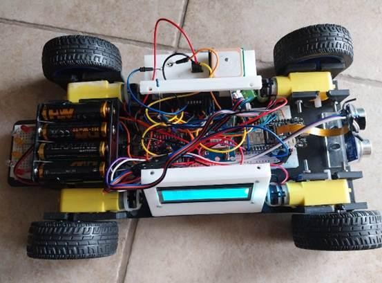
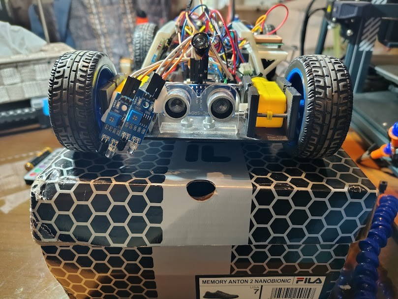
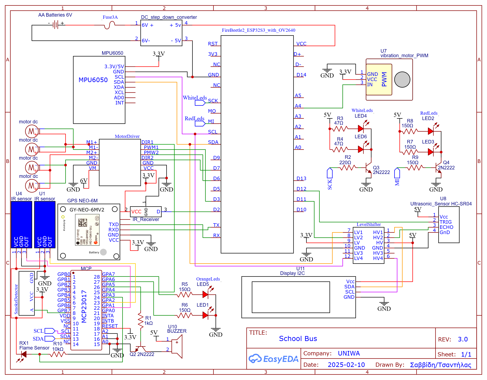
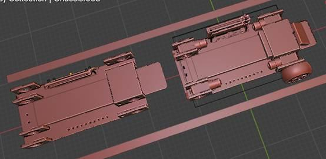
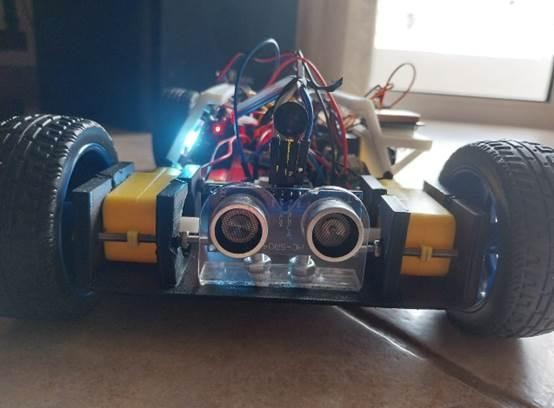
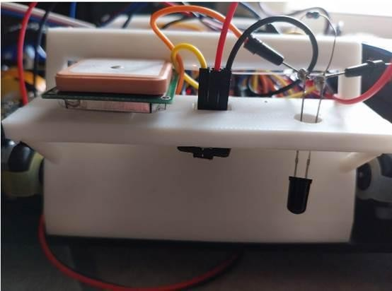
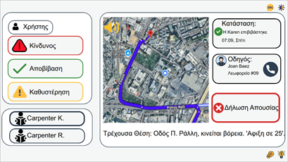
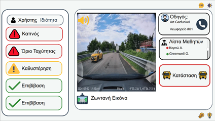

# SafeRoute: Autonomous School-Bus Model (ESP32-S3)

A 4WD model school bus that **follows a taped track with two IR sensors and a gyro-based PID, stops for obstacles, and recognises STOP / NO ENTRY signs with a neural network running on the microcontroller**, plus a Qt desktop app (*SafeRoute*) that shows parents and the school the bus position, live camera and safety alerts.

Team project, University of West Attica (UNIWA), 2026.

  

 

## How it works

| Pillar | What happens | Key details |
|---|---|---|
| **Navigation** | Keeps the bus inside the lane | 2 x IR reflective sensors nudge a target heading by 10 deg steps; an exponential moving average (alpha 0.2) smooths it; a PID on the MPU6050 yaw angle drives the left and right motor pairs differentially (TB6612FNG) |
| **Safety** | Reacts to obstacles and incidents | HC-SR04 in its own FreeRTOS task (100 ms): stop under 10 cm, reverse under 5 cm; smoke, flame, vibration and "picked up" (accelerometer Z outside 0.5-1.5 g) flags shown on the LCD |
| **Vision** | Recognises road signs | OV2640 at 96x96 grayscale; Edge Impulse FOMO (MobileNetV2 0.1, INT8) runs in a FreeRTOS task pinned to core 1, frames shared through a mutex; result served on a debug web page |
| **Monitoring** | Informs parents and school | Qt Quick app: login by role, OpenStreetMap position, live camera, event log fed by JSON over a WebSocket |

Modes: the IR remote switches between **manual** (direct drive) and **automatic** (line following + PID). Status LEDs mimic a real vehicle: red = stopped, white = reversing, orange = turning.

### What is implemented vs. what the report describes

The report (`docs/report_el.pdf`) describes the full scenario. The code in this repository does the following; where they disagree, the code is authoritative.

| Feature | Status |
|---|---|
| IR remote start, manual / automatic modes, speed up / down | Done |
| Line following (2 IR sensors) with gyro PID | Done |
| Obstacle stop (< 10 cm) and back-off (< 5 cm) | Done |
| STOP / NO ENTRY detection on the ESP32-S3 | Done, shown on the debug page. **Does not yet change the driving** (no 3 s pause, no stop on NO ENTRY) |
| Human-figure detection | Not implemented (the model has two classes) |
| Buzzer sounds | Wired, but the calls are commented out in the final firmware |
| Smoke / flame / vibration / pick-up sensing | Read and shown on the LCD |
| App telemetry (GPS, alerts, MJPEG camera) | Works with the separate `firmware/TelemetryLink` sketch, where events are triggered from the serial monitor. The main `SchoolBus` firmware does not send telemetry yet |

## Numbers

| | |
|---|---|
| Model | FOMO with MobileNetV2 0.1 backbone, input 96x96x1, 2 classes (`NO_ENTRY`, `STOP`), INT8, compiled with Edge Impulse EON |
| Training | Edge Impulse, 100 epochs, learning rate 0.001, data augmentation on; 215 training images, 81 / 19 % train / test split |
| Validation (Edge Impulse) | **F1 0.69** (precision 0.64, recall 0.74); STOP 90 % correct, NO_ENTRY 69 % (31 % missed as background), background 100 % |
| Inference on ESP32-S3 | **about 100-150 ms** per frame (about 118 ms in the serial log), no extra optimisation |
| Tensor arena | about 233 KB, allocated in PSRAM (library patched, see [`ml/`](ml/README.md)) |
| Detection threshold in firmware | 0.2 |
| PID | Kp 10, Ki 0.5, Kd 0.05; integral clamped to +-100; derivative on measurement; output +-255 PWM |
| Base speed | PWM 225 (remote adjusts 70-255 in steps of 10) |
| Firmware | about 880 lines of C++ in the final sketch (1,600 with comments) |

**How to read the accuracy:** the validation set is small and comes from the same capture sessions as the training images, so these numbers are optimistic. On the real track the detector was noticeably less reliable; the report attributes this to too little real-world training data. Details in [`ml/`](ml/README.md).

## Hardware

Schematic (EasyEDA, rev 3.0): [`electronics/schematic.png`](electronics/schematic.png). Bill of materials: [`BOM`](electronics/BOM.csv).

Two power domains: a 600 mAh Li-Po feeds the ESP32-S3 and camera, a 4 x AA pack (via a 3 A fuse and a 1000 uF capacitor) feeds the motors, so motor current dips do not reset the controller.

| Function | Pin |
|---|---|
| Camera OV2640 | fixed by the board (XCLK 45, D0-D7 39/40/41/4/7/8/46/48, VSYNC 6, HREF 42, PCLK 5); SCCB shares the main I2C bus |
| Motor driver PWM left / right | D3 / D6 |
| Motor driver DIR left / right | MCP23017 GPB7 (pin 15) / D7 |
| HC-SR04 TRIG / ECHO | D11 / D12 (through the level shifter) |
| IR receiver (remote) | D2 |
| IR line sensors left / right | MCP23017 GPA1 / GPA2 |
| Flame / smoke sensor | MCP23017 GPA3 / GPA4 |
| Buzzer | MCP23017 GPA5 (via 2N2222) |
| LEDs red / white | GPIO 16 / 17 (via 2N2222) |
| LEDs orange left / right | MCP23017 GPA7 / GPA6 |
| Vibration sensor | A4 (analog, threshold 500) |
| GPS NEO-6M RX / TX | 44 / 43 (UART0, 9600 baud) |
| I2C devices | LCD 0x27, MPU6050 0x68, MCP23017 0x20, AXP313A PMIC (on board) |

The `D`/`A` names are the FireBeetle 2 board aliases, so the sketch must be compiled for that board.

### Chassis and build

The chassis was modelled in Blender around imported models of the wheels, motors and sensors, sized for the 200 mm lane, and 3D-printed in PLA. Renders: [`docs/cad/`](docs/cad/).

More photos in [`docs/images/`](docs/images/).

### Track

Black 18 mm tape on a matte surface, closed loop, lane 200 mm wide, double edge lines 20 mm apart, no crossings, curve radius above 30 mm.

## Build and flash

See [`firmware/README.md`](firmware/README.md) for the full list. In short:

1. Install the **DFRobot FireBeetle 2 ESP32-S3** board package; enable PSRAM (the camera frame buffer and the model arena live there).
2. Copy `firmware/libraries/a0912_inferencing` into your Arduino `libraries` folder (it is the Edge Impulse export with a small PSRAM patch).
3. Install the libraries listed in the firmware README.
4. Copy `firmware/SchoolBus/secrets.example.h` to `secrets.h` and enter your Wi-Fi.
5. Open `firmware/SchoolBus/SchoolBus.ino` and upload. The debug page is at `http://esp32-data.local/` (camera + detected sign).

## The SafeRoute app

Qt Quick (QML) project made with Qt Design Studio, in [`app/SafeRoute/`](app/README.md). Two roles share one login screen: **school** (route list, map, driver, student list, live camera and event log) and **parent** (child selector, map with ETA, absence button). Each screen has a light and a dark variant. Login is a demo: user name `school` or `parent`, no password check.

 

## Design decisions

- **IR sensors instead of the camera for line following.** The first version binarised the camera image and steered from the black / white balance on each side ([`firmware/experiments/CameraLineDetection`](firmware/experiments/CameraLineDetection/)). Side light from windows and frames that showed only one line made it unreliable, so two IR sensors took over and the camera was kept for signs.
- **Edge AI on the microcontroller.** No cloud round trip, works offline, and images never leave the car.
- **FOMO instead of a pretrained detector.** A 2-class FOMO model trained on the car's own 96x96 grayscale frames runs directly on the camera buffer; a general model (YOLO, MobileNet-SSD) would need RGB, resizing and many unused classes.
- **FreeRTOS tasks.** Ultrasonic timing and inference run in their own tasks so the control loop is never blocked; a mutex keeps the camera from overwriting a frame the model is reading.
- **I/O expander.** The camera takes most GPIOs, so LEDs, buzzer, line and safety sensors and one motor direction line moved to an MCP23017; the loop re-initialises it if it drops off the I2C bus.
- **Edge Impulse arena in PSRAM.** The library's allocator was patched to request PSRAM explicitly (internal RAM only as a fallback), so the ~233 KB tensor arena does not compete with Wi-Fi and the camera driver for internal RAM.

## Lessons learned

- Camera line detection with global, row-based and adaptive thresholds all worked in a controlled room and failed under side lighting; an edge filter (Sobel / Canny) would be the next step.
- Validation scores from the training platform did not carry over to the track; more images taken on the real track, at several distances, are needed.
- The MCP23017 occasionally dropped off the shared I2C bus, so the loop checks it every 5 s and re-initialises it.

## Known limitations and roadmap

- Merge `TelemetryLink` (WebSocket JSON + MJPEG stream) into the main firmware so the app receives real sensor data, and make the sign detections act on the driving (pause at STOP, standby at NO ENTRY).
- `readGyro()` divides the raw `int16_t` values by 131 in integer arithmetic, so yaw rate is quantised to 1 deg/s steps; use floats.
- In automatic mode the target angle changes by +-10 deg on every loop pass (every few milliseconds) unless the two IR sensors read the "centred" pattern, and it has no limit; clamp it or make the step time-based.
- Re-enable the buzzer patterns (beep on start, reverse warning, alarm).
- Replace Arduino `String` with fixed buffers in the web handlers; split the sketch into modules.
- Collect a larger dataset on the real track; add a "person" class for the human-figure scenario.

## Repository layout

| Folder | Contents |
|---|---|
| [`firmware/`](firmware/README.md) | `SchoolBus` (final), `TelemetryLink` (app link demo), patched Edge Impulse library, experiments and earlier versions |
| [`ml/`](ml/README.md) | How the sign detector was trained and evaluated |
| [`app/`](app/README.md) | SafeRoute Qt Quick application |
| [`electronics/`](electronics/) | Schematic and BOM |
| [`docs/`](docs/) | Flowcharts (PlantUML-generated), photos, CAD renders, app screenshots, report |

## Credits and AI assistance

Edge Impulse (model training and SDK), Qt / Qt Design Studio (app and bundled Qt Quick Studio Components, GPL-3.0), DFRobot, Adafruit, TinyGPS++, IRremote, OpenStreetMap. The function flowcharts were produced by converting the C++ to PlantUML with a ChatGPT assistant and rendering it in the PlantUML editor (see [`docs/flowcharts/`](docs/flowcharts/README.md)); the SafeRoute logo was made with a generative image model.

Project report (Greek): [`PDF`](docs/report_el.pdf)

## License

No license has been chosen yet. Third-party code keeps its own license: the Edge Impulse SDK in `firmware/libraries/` and the Qt Quick Studio Components in `app/SafeRoute/Dependencies/` (GPL-3.0).
