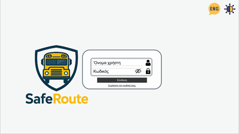
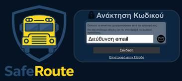
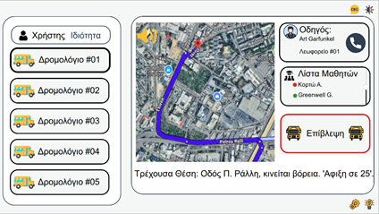

# SafeRoute app

Desktop monitoring app for parents and the school, built with **Qt Quick (QML)** in Qt Design Studio / Qt Creator. The project folder is [`SafeRoute/`](SafeRoute/); inside it the Qt project and modules keep their original name, `Car_Test2`, because Qt Design Studio generates code from that name.

 

## Screens

| Role | What it shows |
|---|---|
| Login (shared) | User name and password; password recovery by e-mail. Demo logic: user name `school` or `parent`, no password check |
| School | Routes #01-#05, OpenStreetMap with the bus position and ETA, driver card with call button, student list with on / off-board status. **Supervision** swaps the map for the live camera and the left column for the event log |
| Parent | Child selector, colour-coded alerts (danger red, drop-off green, delay yellow), map with ETA, last status of the child, driver card, absence button |

  

## Connection to the car

`Car_Test2Content/App.qml` connects to the [`TelemetryLink`](../firmware/TelemetryLink/) firmware:

- `ws://esp32s3-data.local:81`: JSON every 2 s with `lat`, `lng`, `smoke`, `flame`, `vibration`, `arrival`, `departure`, `busDelay`, `speedLimit`, `uptime`; each flag that turns true adds one notification. The socket reconnects every 3 s if it drops.
- `http://esp32s3-data.local/stream`: MJPEG camera feed, retried on error.

If mDNS (`.local` names) does not resolve on your network, put the board's IP address in those two URLs.

## Build

1. Install Qt 6.8 or newer (the project was last configured with **Qt 6.9.3, MinGW 64-bit**) with the add-on modules **Qt WebSockets, Qt Location, Qt Positioning, Qt Multimedia**, plus Qt Quick Timeline and Shader Tools.
2. Open `SafeRoute/CMakeLists.txt` in Qt Creator (or `SafeRoute/Car_Test2.qmlproject` in Qt Design Studio).
3. Build and run. `Dependencies/` holds the Qt Quick Studio Components that Qt Design Studio bundles (GPL-3.0); they are built with the app.

Per-user IDE files (`*.user`, `*.qtds.<hash>`) were removed and are now ignored.
