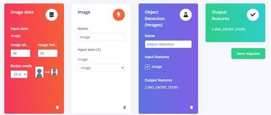
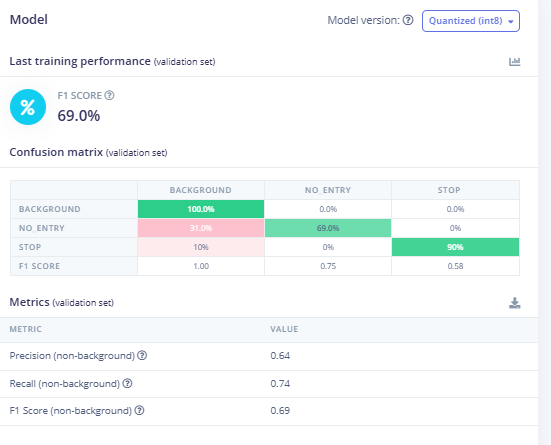
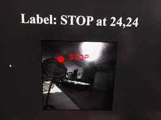
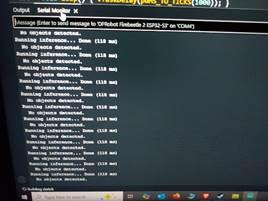

# Sign detector (Edge Impulse)

The car recognises two road signs, **STOP** and **NO ENTRY**, with a FOMO object-detection model trained on Edge Impulse and run on the ESP32-S3. Training happened on the Edge Impulse web platform, so there are no training scripts here; this page records what was done and what came out. The deployable result is the Arduino library in [`firmware/libraries/a0912_inferencing/`](../firmware/libraries/a0912_inferencing/) (Edge Impulse project ID 849279, "0912").

## Pipeline

| Stage | What was done |
|---|---|
| 1. Data | Photos taken with the car's own OV2640 at **96x96 grayscale** (the same settings the firmware uses: auto exposure, gain and white balance off, fixed exposure 1200, downsize on), from several angles and lighting conditions |
| 2. Labelling | Bounding boxes drawn in the Edge Impulse labelling queue; automatic split **81 % training / 19 % test** (215 training images) |
| 3. Impulse | Image input 96x96 (already the capture size), image processing block in **grayscale**, object-detection learning block, target device ESP-EYE (ESP32, 240 MHz) for latency and memory estimates |
| 4. Training | **FOMO, MobileNetV2 0.1 backbone**, 100 training cycles, learning rate 0.001, data augmentation on, CPU training |
| 5. Deployment | Arduino library, **quantised INT8**, EON-compiled; then patched for PSRAM (below) |

  

## Results

| | Background | NO_ENTRY | STOP |
|---|---|---|---|
| Correct | 100 % | 69 % | 90 % |
| Missed as background | - | 31 % | 10 % |
| F1 | 1.00 | 0.75 | 0.58 |

Overall (non-background): precision 0.64, recall 0.74, **F1 0.69** on the validation set, INT8 model.

On the ESP32-S3 one inference takes **about 100-150 ms** (118 ms in the serial log below), without compiler flags, vectorisation or the S3's 128-bit SIMD instructions.

  

### What the numbers mean

- The validation set is small and comes from the same sessions as the training images, so these scores are optimistic. On the real track (different light, larger distances) detection was clearly less reliable. More images from the track itself are the main fix.
- STOP scores better than NO_ENTRY. A likely reason is shape: the octagon's corners and straight edges are distinctive, while a red circle resembles many other round things in the scene.
- FOMO outputs object **centroids** on a coarse grid, not box sizes; the firmware uses the first centroid with confidence above **0.2** (lower than Edge Impulse's default 0.5).
- The firmware only reports the detection (debug page); it does not yet change the driving.

## Why FOMO and not a pretrained detector

A general model (YOLO, MobileNet-SSD) is trained on RGB images at higher resolution and on many classes the car never meets. Running it on the ESP32-S3 would cost memory and time, and every 9,216-byte frame would need converting. A 2-class FOMO model trained on the camera's own 96x96 grayscale frames runs on the buffer with only one step: each pixel is shifted by -128 into the INT8 range (`convertBufferForAI`).

## Library patch

The library in `firmware/libraries/a0912_inferencing` is the Edge Impulse export (`ei-0912-arduino-1.0.5`) with two files changed. The unchanged export and the patched copy were both committed as zip files; they were removed in the cleanup and are in the git history.

| File | Change |
|---|---|
| `src/edge-impulse-sdk/porting/espressif/ei_classifier_porting.cpp` | `ei_malloc` asks for 16-byte-aligned **PSRAM** first and falls back to internal RAM; `ei_calloc` reuses it; `ei_free` uses `heap_caps_free` |
| `src/model-parameters/model_metadata.h` | `EI_CLASSIFIER_TFLITE_LARGEST_ARENA_SIZE` changed from 287104 to `200 * 1024` |

The EON-compiled model declares its own tensor arena of 238,544 bytes (`tflite-model/tflite_learn_849279_3_compiled.cpp`) and allocates it through `ei_malloc`, so it ends up in PSRAM. If you re-export the model from Edge Impulse, re-apply the `ei_classifier_porting.cpp` change.
